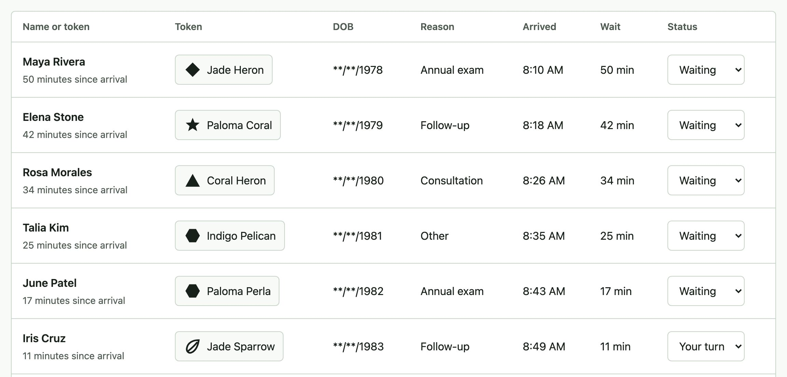
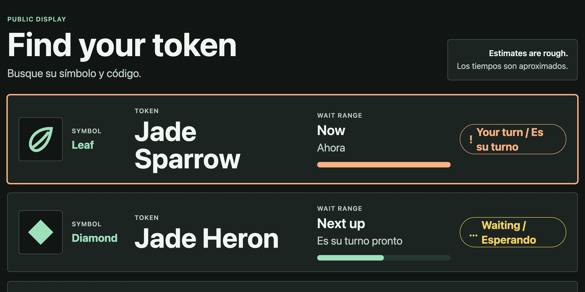

# Sala

A front-desk check-in prototype for clinics where the visit itself is sensitive. Staff see what they need. The waiting room sees a glyph, a token, a wait range, and a status. Nothing else.

- **Status:** working prototype with synthetic data. Not validated with users.
- **Live demo:** [sala-privacy-board.netlify.app](https://sala-privacy-board.netlify.app)
- **Design file:** [Sala in Figma](https://www.figma.com/design/mTrNMj9qBNuaMK88hOovGv)
- **Usability testing:** planned, not yet run. See [`docs/USABILITY_PLAN.md`](docs/USABILITY_PLAN.md).

[](https://github.com/Nicolercc/Sala/actions/workflows/ci.yml)

All data is synthetic. No real patient information was used at any point, and the demo asks visitors to use a made-up name and birth date.

## Try it in a minute: one patient, two surfaces

1. **Open the [staff queue](https://sala-privacy-board.netlify.app/staff).** Maya Rivera is first in line: masked birth date, visit reason, arrival time, and her token, **Jade Heron**.
2. **Open the [waiting-room board](https://sala-privacy-board.netlify.app/board)** (ideally in a second window, as it would be on a TV). The same patient appears only as the diamond glyph and **Jade Heron**, with "Next up" and a status. No name, birth date or visit reason.
3. **On the staff queue, turn on "See what the room sees".** Each row switches to exactly the fields the board receives, from the same projection.

**Staff queue (front desk):** Maya Rivera is token Jade Heron.



**Waiting-room board (public):** the same token, and nothing else about her.



The demo runs on a synthetic clock that starts on the seed morning, so the waits shown are minutes, not months.

## The idea

Sala focuses on the in-clinic arrival and waiting-room display layer, where privacy exposure can still happen even when intake is handled elsewhere. One arrival record renders differently on each surface. The waiting-room board's renderer never receives names, dates of birth, visit reasons, notes, or internal IDs: its data passes through an allow-list projection first, and tests fail if that changes. In this browser-only prototype that is a code boundary, not a network one (see the limits below).

The core product idea is a display contract: each surface names the fields it is allowed to show, the fields it is forbidden to show, and the tests that prove the contract.

## Screens

- `/`: the single-page demo. A check-in kiosk, the staff console (full records, a privacy lens, and an idle lock), "the wall" (shows exactly which fields cross to the board, and blocks an attempt to send a name), and the waiting-room board.
- `/checkin`: front-desk form for adding an arriving patient to the synthetic queue.
- `/staff`: front-desk queue with masked DOB, visit reason, status changes, and the waiting-room lens.
- `/board`: public waiting-room board with glyph, token, wait range, and status only.
- `/design-system`: component, token, annotation, and display-contract reference.
- `/case-study`: explanation of the flow, privacy boundary, accessibility decisions, and test evidence.

`/` uses shape-and-number tokens ("Triangle 14") and its own in-page arrival records. The separate routes use the original color-and-bird tokens ("Garza Coral") and the shared patient store. Both boards go through the same allow-list.

## Privacy architecture

```
staff-side arrival records
  -> privacy projection         keeps only surfaces.publicBoard, deny by default
  -> public board row           { glyph, tokenLabel, waitRange, status }
  -> waiting-room UI
```

- **The allow-list** is `surfaces.publicBoard` in [`src/policy/visibility.ts`](src/policy/visibility.ts). `pickSurfaceFields()` in the same file is the one function that applies it. Anything not on the list is dropped, including fields added to a source record later.
- **`/board`** renders from `getBoardFeed()` ([`src/feeds/board.ts`](src/feeds/board.ts)), which serializes `project(patient, "publicBoard", ...)`. `BoardFeedBridge` is the one module on the route that reads the patient store. The renderer, `BoardDisplay`, receives only the serialized feed and cannot reach the store or the `Patient` type through any import chain (checked by `src/policy/boardBoundary.test.tsx` and an ESLint `import/no-restricted-paths` rule).
- **`/`** renders its board from `getKioskBoardFeed()` and `projectKioskRecord()` ([`src/feeds/kioskBoard.ts`](src/feeds/kioskBoard.ts)), built on the same `pickSurfaceFields()`. The board renderer in `src/app/salaHomeScript.js` sits outside the code that holds the arrival records and receives only board rows.
- **The staff views** read full records directly; that is their job. On `/staff`, the lens shows exactly the board projection (unit-tested). On `/`, the lens replaces names with initials and hides birth date and visit.

Restricted fields are removed before any waiting-room code runs, not hidden with CSS. Limits:

- Both boards run in the same browser as the staff views, so this is a code-level boundary. On `/board`, the shared in-memory patient store is still loaded in the page (the route sits inside the app's `PatientProvider`), so someone with developer tools on the board device could read full records. A production version would apply the same projection on a server and send the display device only the projected feed.
- The allow-list controls which fields cross, not what an allowed field contains. Tests check that sample names and sensitive values do not appear inside allowed fields, but only for the inputs they cover.
- This is not a security certification.

### Privacy requirements

| ID | Requirement | Enforced by |
| --- | --- | --- |
| PR-1 | Board payload contains only glyph, tokenLabel, waitRange, status | Allow-list projection; unit tests on both board feeds |
| PR-2 | All data synthetic, fixed seed | `src/lib/seed.ts` |
| PR-3 | Fixtures contain no SSN, phone, email, or MRN-like patterns | Unit test |
| PR-4 | No browser storage used | E2E test after a full check-in on `/` |
| PR-5 | No patient fields in logs | `src/lib/logger.ts` redacts known keys; lint bans `console` |
| PR-6 | No third-party requests | E2E test on every route that fails on another origin |
| PR-7 | DOB masked on staff view | Visibility policy |
| PR-8 | Idle blur at 60s | E2E test with a mocked clock |
| PR-9 | Lens output equals board output for every patient on `/staff` | Unit test |
| PR-10 | Extra fields on a source record never reach the board | Unit tests that add SSN, MRN, phone, email, insurance, and diagnosis fields |
| PR-11 | A newly checked-in patient appears on `/board` only through public fields; the board renderer has no import path to patient records | Render test with a sentinel patient; transitive import test; lint rule |

## Accessibility

Visible labels, native form controls, visible focus rings, and text plus icons for status. The check-in flow does not ask for the same information twice (WCAG 3.3.7), and its review step is a definition list with a distinctly named Edit button per row. Measured at 390px and 1440px, every interactive target on every route and check-in step is at least 24×24 CSS px, except one: the 21px-tall "Open the Figma file" footer link on `/`. Themes: light, dark, and high contrast.

These are automated and manual checks by the author. There has been no screen-reader session with assistive-technology users. This is not a WCAG conformance claim.

## Testing

### Automated testing completed

As of September 30, 2026, all 30 unit tests and all 35 browser tests pass.

Unit tests (Vitest) cover:

- the projection for each surface, and extra source fields being dropped
- both board feeds: only public fields, with no names or birth dates (and on `/`, no notes or internal IDs)
- token uniqueness and determinism
- wait range math
- synthetic fixture safety
- reducer actions and validation
- staff lens output matching the board feed
- design token coverage by theme
- display contract alignment with the projection policy

Browser tests (Playwright with axe-core) cover:

- visiting all routes
- a full check-in on `/` reaching the board, with empty browser storage afterwards
- the waiting-room markup containing no private values while the staff console keeps the full record
- a blocked attempt to send a name to the board
- the privacy lens hiding birth dates and names
- no third-party requests on any route
- axe on every route in light, dark, and high-contrast themes
- axe on every check-in step (form, errors, visit, review, confirmation) at 320, 390, and 1440px
- no page-level horizontal scroll on any route at 320, 390, 430, and 768px
- the staff table scrolling inside its panel on phones, with keyboard focus reaching it
- idle blur and resume

### Usability testing: planned, not yet completed

[`docs/USABILITY_PLAN.md`](docs/USABILITY_PLAN.md) describes short moderated sessions using synthetic data only: research questions, participants, a consent script, tasks, success signals, and note and write-up templates. No sessions have been run, so there are no findings yet.

## Running it

Requirements:

- Node 20 or 22. Netlify builds with Node 20; CI and local verification use Node 22.
- pnpm 9.15.9, pinned in `package.json` (`packageManager`). Corepack uses the pin automatically, and pnpm 11 switches to it when run in this folder.

| Task | Command |
| --- | --- |
| Install | `pnpm install` |
| Local development | `pnpm dev` (http://localhost:3000) |
| Typecheck | `pnpm typecheck` |
| Lint | `pnpm lint` |
| Unit tests | `pnpm test` |
| Browser and accessibility tests | `pnpm test:e2e` (first run: `pnpm exec playwright install chromium`) |
| Typecheck, lint, unit, and browser tests together | `pnpm check` |
| Production build | `pnpm build` (static export to `out/`) |

## Deployment

`netlify.toml` builds with `pnpm build` and publishes `out/`, using Node 20 and pnpm 9. `.github/workflows/ci.yml` runs install, typecheck, lint, unit, and browser tests on every push and pull request.

## Research and privacy docs

- [`docs/PRIVACY_MODEL.md`](docs/PRIVACY_MODEL.md): assets, risks, controls, integration story, and limits.
- [`docs/USABILITY_PLAN.md`](docs/USABILITY_PLAN.md): moderated session plan using synthetic data only.
- [`docs/SPEC.md`](docs/SPEC.md): the original product and data specification.
- [`src/policy/displayContract.ts`](src/policy/displayContract.ts): allowed fields, forbidden fields, and proof for each display surface.

## Design file

The [Figma file](https://www.figma.com/design/mTrNMj9qBNuaMK88hOovGv) cover lists pages for foundations, components, check-in, staff, board, data boundary, handoff, and portfolio. Its portfolio frames (MR-1 to MR-6: hero, boundary, privacy lens, check-in, waiting-room board, display contract) and check-in frames built from shared components (stepper, error summary, text field, token card, button) have been reviewed. The `/case-study` page does not include Figma images yet.

## Production integration

In production, Sala would sit beside an EHR or patient-access platform. A server-side projection layer would map appointment and arrival state into a display-safe queue record. The public board would never query the EHR directly. It would receive only a minimum-necessary feed scoped to a location.

## What this is not

A prototype, not a product. It has no authentication, backend, or persistence, it has not been tested with users, and it is not HIPAA compliant; compliance is a legal and organizational status. A production version would need a risk analysis, business associate agreements, role-based access with audit logging, encryption in transit and at rest, and a display-only role that the server never sends PHI to.

## Known gaps

- `/` and the separate routes use two different token designs.
- `/board`, `/checkin`, and `/staff` ship about 1 MB of JavaScript, mostly the synthetic data generator.
